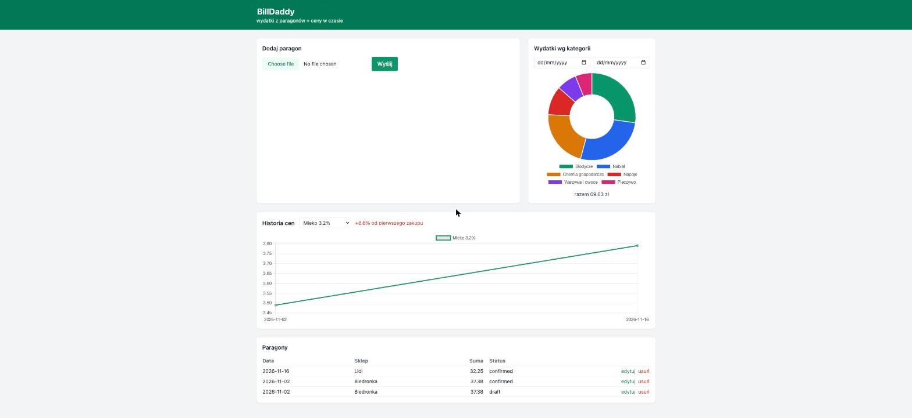

# BillDaddy

Small app for tracking home expenses from photos of shop receipts. You upload a photo, it reads the items (OCR), matches them to known products, guesses a category and lets you fix everything before saving. On top of that it shows how prices of the same products change over time (my own "inflation index").



## Stack

- Python 3.11, Flask, SQLAlchemy, Flask-Migrate
- MySQL 8
- Tesseract OCR (`pol`) + TheFuzz for matching product names
- optional: OpenAI vision model instead of Tesseract
- Tailwind + Chart.js (no build step, just CDN)
- Docker / docker compose

## Running

```
cp .env.example .env
docker compose up --build
```

App is on http://localhost:5001 (5000 is taken by AirPlay on macOS). Migrations and seed (categories + a few products) run on container start.

Login is `admin` / `admin` by default — change `ADMIN_USERNAME` / `ADMIN_PASSWORD` in `.env`.

To use OpenAI instead of Tesseract set in `.env`:

```
OCR_ENGINE=openai
OPENAI_API_KEY=sk-...
```

## How it works

1. `POST /api/receipts` with an image → OCR → `app/ocr/parser.py` pulls out shop, date, total and lines like `ML.ŁACIATE 3,2% 1L  2 x3,49  6,98C`
2. every line goes through `app/services/normalizer.py`:
   - if the same raw name was already confirmed before → that product
   - otherwise fuzzy match (`token_set_ratio` on cleaned names, threshold 80)
   - no match → category guessed from keywords (`app/services/categorizer.py`)
3. receipt is saved as `draft`, user fixes names/categories/prices in the UI
4. `PUT /api/receipts/<id>/confirm` → new products are created, receipt becomes `confirmed`
5. only confirmed receipts count in stats

## API

All endpoints require login (session cookie).

| method | url | |
|---|---|---|
| POST | `/api/receipts` | upload (`multipart`, field `image`) |
| PUT | `/api/receipts/<id>/confirm` | save corrected items |
| GET | `/api/receipts`, `/api/receipts/<id>` | |
| GET | `/api/receipts/<id>/image` | the uploaded receipt photo |
| DELETE | `/api/receipts/<id>` | |
| GET | `/api/categories`, `/api/products` | |
| GET | `/api/stats/categories?from=&to=` | spending per category |
| GET | `/api/stats/prices/<product_id>` | price history + % change |

## Tests

```
pip install -r requirements.txt
pytest
```

Tests use sqlite in memory, OCR is mocked.

## TODO

- discounts (`RABAT` lines are just skipped for now)
- editable keyword list for categories
- better preprocessing for crumpled receipts (deskew)
